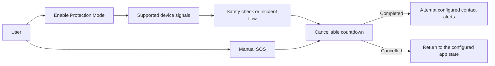

# How Garly works

Current product overview, updated 9 October 2026. Garly is available on iOS and Android. This document describes user-facing behaviour without publishing backend code or production infrastructure.

## Manual SOS and Protection Mode

Manual SOS is available independently of AI, learned routines and Protection Mode. It starts the configured cancellable alert flow. When that flow completes, Garly attempts to notify the user's configured trusted contacts with an available location.

Protection Mode is an optional monitoring session. On supported devices, it uses permitted motion and location signals to support checks for potentially significant events. Sensitivity and carrying-position settings help account for normal activity. Detection and delivery are not guaranteed.

## Stillness checks

With Protection Mode and a stillness threshold enabled, the app can ask for confirmation after a period without meaningful movement. The user can confirm they are okay or intentionally waiting. If the check expires unanswered, it can enter the configured SOS countdown flow.

Respond to the on-screen stillness control: writing an ordinary chat message does not dismiss that control or cancel an SOS timer. The deterministic app flow owns these timers, not the language model.

## Walk Mode

Walk Mode is enabled deliberately for timed check-ins. If the person stops responding for the selected interval, the configured countdown and trusted-contact alert flow can begin. It is not simply a casual conversation mode.

Permissions, platform restrictions and the app's ability to run still matter. A scheduled local notification alone is not proof that a remote alert was sent.

## Live Journey

Live Journey shares a temporary, updating location link. It is separate from Walk Mode and from a one-time SOS location. Sharing can be stopped by the user; ending a share does not itself prove they arrived safely.

Treat the link as private: someone who obtains it may be able to view the shared position while it is valid.

## Last-Known Location

This optional feature is off until the user enables it while connected, grants the required permissions and chooses recipients.

1. Choose an alert threshold: **10 minutes, 30 minutes, 1 hour or 2 hours**.
2. Confirm activation and allow the phone to send its check-ins and available location.
3. If the server stops receiving check-ins for the selected duration, it can send the last saved position to the selected contacts through **Telegram or email**.
4. The message includes the position's recorded time and available accuracy. Delivery can still fail or be delayed by external services.

The phone does not need to reconnect for the server to send information it already received. The feature cannot upload a new position after connectivity has been lost. GPS loss alone is different from the server no longer receiving check-ins.

It does not detect an earthquake, collapse or other disaster. A dead battery, lost signal, force-closing the app or operating-system restrictions can also interrupt updates.

Pause while connected and wait for server acknowledgement. Stopping locally while offline cannot immediately cancel a deadline already held by the server. A connection-restored notice means updates resumed; it does not certify that the person is safe.

## Trusted contacts and delivery

General SOS delivery can use supported, configured Telegram, WhatsApp and email channels. Telegram contacts must complete the linking flow. WhatsApp requires the sender's linked account. Availability depends on configuration and service status.

Last-Known Location currently uses Telegram and email; do not assume that every general SOS channel is available for that feature.

Starting a countdown, attempting a send, receiving provider acceptance and the recipient reading a message are different states. The companion must not claim successful delivery without a corresponding result.

## Companion checks are separate

The companion may ask a brief foreground question after selected events or a confirmed routine schedule. These conversational questions do not trigger SOS or contact messages when ignored. See [companion behaviour and progression](COMPANION.md).

## Free safety and optional features

Core safety does not require a subscription, wallet, token, invitation or evolution level. Pro personalises the companion experience. City Ambassadors and other community features are separate from emergency protection.

No emergency action or crisis disclosure earns evolution XP. A safety mode should be enabled because it is useful, not simply to collect points.

## Platform and safety limits

Android background services and iOS background capabilities differ. Permissions, battery management, force-stop behaviour and connectivity can affect operation. Features do not provide guaranteed continuous observation or emergency-service dispatch.

Garly does not replace emergency services, medical assistance or local authorities. The public native source snapshots are older than the current store builds; see their directory notices before using them as implementation references.
